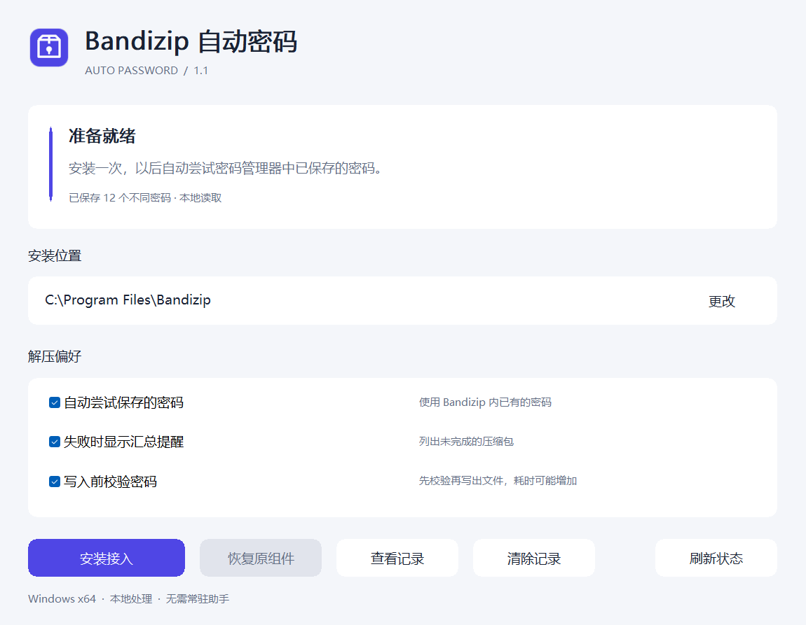

# Bandizip Auto Password

自动尝试 Bandizip 密码管理器中保存的密码，跳过并汇总密码不匹配的压缩包。



- 保留双击打开和原生右键解压入口，无需后台助手。
- 支持批量解压、不同文件使用不同密码、选中文件解压。
- 默认先校验密码再写出文件，避免 ZIP 弱密码检查造成错误输出。
- 提供失败提醒、解压记录及原引擎恢复。

## 支持范围

**Windows 10/11 x64，Bandizip 7.47.0.1，指定引擎构建。** 安装器自动核验兼容性。

这是非官方的引擎转发扩展。macOS、Linux、Windows x86 和原生 ARM64 暂不支持；没有对应平台的发行包。设置密码管理器主密码时使用 Bandizip 原生密码窗口，不自动解锁。`bz.exe`、自解压程序和内存流入口不启用自动匹配。

## 使用

1. 从 Releases 下载 Windows x64 包，完整解压。
2. 关闭 Bandizip，运行 `BandizipAutoPassword.exe`，确认安装目录，点击“安装接入”。按 Windows 提示完成管理员授权。
3. 关闭管理器，照常解压。密码继续在 Bandizip 自己的密码管理器中维护。

卸载扩展：关闭 Bandizip，在管理器中选择“恢复原组件”。Bandizip 升级后可能需要重新适配。

预校验会额外读取并解压一次选中的加密内容，大型固实压缩包可能明显变慢。可在管理器关闭预校验。

## 数据

扩展不联网，不保存或上传密码。解压记录仅写入本机 `%LOCALAPPDATA%\BandizipAutoPassword`，包含归档路径、结果和尝试次数。支持清除记录，每个记录文件最多滚动保留两份约 5 MiB 文件。

## 开发

PowerShell 7、Zig 0.13.0。引擎来自本机 Bandizip 安装，不随项目分发。

```powershell
./tools/bootstrap-zig.ps1
./build.ps1 -Tests -OutputDirectory release
python -m pip install -r tests/requirements.txt
python tests/integration.py --package release --zig tools/.toolchain/zig-windows-x86_64-0.13.0/zig.exe
```

测试使用隔离的应用副本、注册表和虚拟密码。发布前运行 `python tools/privacy_check.py`。验证范围与实现约束见 [审计说明](docs/AUDIT.md)。

项目代码采用 MIT 许可证；Mbed TLS Blowfish 采用 Apache-2.0，见 `THIRD_PARTY_NOTICES.txt`。
